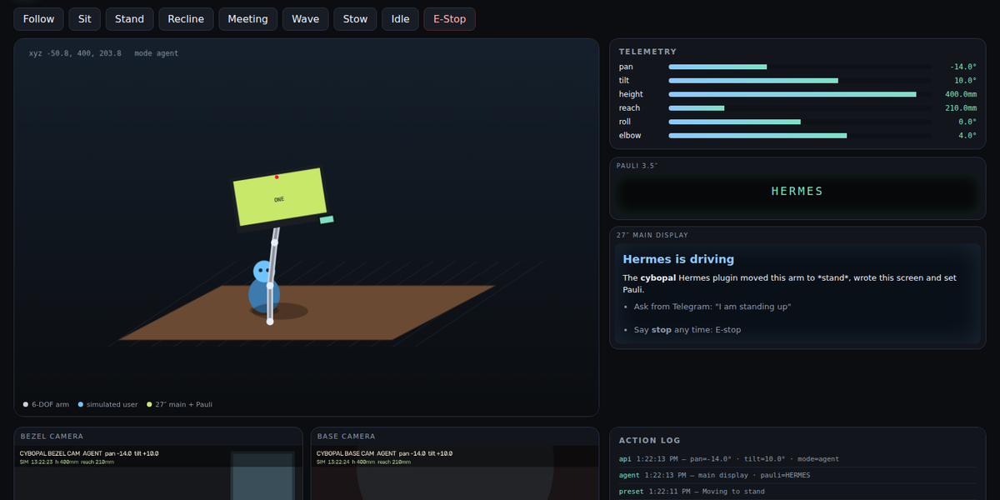
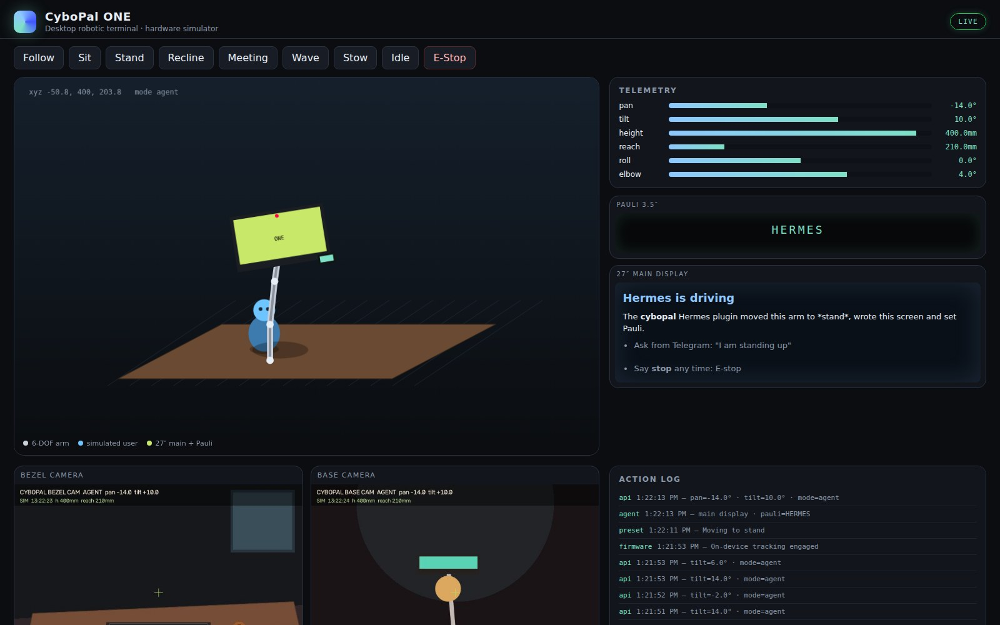
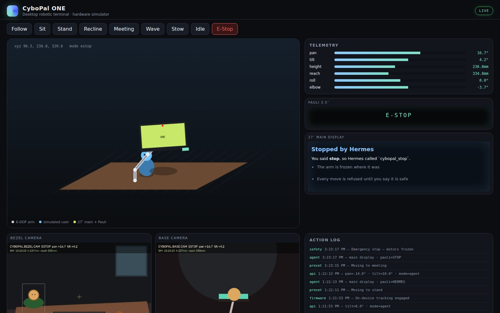

# CyboPal ONE DevKit for Hermes (unofficial)



Drive a **CyboPal ONE** from [Hermes Agent](https://hermes-agent.nousresearch.com/): ask in plain words from Telegram,
Discord, the Desktop app or the CLI, and Hermes moves the robotic screen, writes on its displays, looks through its
cameras, and stops it the moment you say stop.

[CyboPal ONE](https://cybopal.com/) is a 27-inch 4K screen on a 6-DOF robotic arm (700 mm reach) with a 3.5-inch Pauli
companion display and two cameras. It has no public developer API yet, so this plugin works against the
**CyboPal ONE DevKit's live simulator**, which defines the HTTP contract the DevKit keeps for the hardware. When the
device ships, point `device_url` at it.

> **You need the simulator (or the device) running.** The DevKit is free and open source:
> https://github.com/drowzeys/keys-CyboPal-ONE-Hermes-DevKit-LiveSimulator-Nemotron3Nano-Omni-for-DGX-Spark
>
> ```bash
> docker run --rm --network host ghcr.io/drowzeys/keys-cybopal-one-hermes-devkit:0.1.0
> # or: git clone ... && ./oneshot.sh
> # then open http://127.0.0.1:5000/ to watch the arm move
> ```

## Install

1. Start the DevKit simulator (above). It needs no GPU.
2. Install the plugin:

   ```bash
   hermes plugins install drowzeys/hermes-cybopal-one-devkit --enable
   ```

3. If the simulator runs on another machine, set its address in the plugin's settings
   (`plugins.entries.cybopal-one-devkit.settings.device_url`, for example `http://192.168.1.20:5000`).
   Restart the gateway so it loads the plugin. Its tools are in the `cybopal_devkit` toolset.

## What you can ask

- "Follow me." · "I'm standing up now." · "Lean back, I'm reclining." · "Put the screen away."
- "Turn the screen 20 degrees to the right and tip it down a little."
- "Put a 25-minute focus timer on the big screen and FOCUS on Pauli."
- "What does the front camera see? Am I in frame?"
- "Wave hello." · "Nod." · "Run the posture cycle."
- "**Stop!**": freezes the arm at once. It stays stopped until you say it is safe again.
- "Make a revenue chart from my spreadsheet and put it on the big screen." (with Hermes's code tool)
- "Make a short video of a fox in the snow and show it on the monitor." (with the Imagination Studio plugin)
- "Scan this receipt." · "Take a selfie." · "Tell me a joke." · "I'm having a rough day." · "Make me a meme."
- "Design a stretch-break routine, try it, and save it."

Or the command: `/cybopal`, `/cybopal stop`, `/cybopal sit`, `/cybopal say HELLO`, `/cybopal show # Hi`,
`/cybopal look`, `/cybopal run wave-hello`, `/cybopal resume`.

## Screenshots

Hermes moved the arm to *stand*, set an exact pan and tilt, and wrote both screens:



"Stop!": the arm froze, and every move is refused until the person says it is safe:



## Tools

- `cybopal_status`: mode, arm pose, both screens, safety (E-stop, collision, in bounds), where the person is in the
  front camera, joint limits, recent events.
- `cybopal_mode`: `follow`, `sit`, `stand`, `recline`, `meeting`, `stow`, `wave`, `idle`; waits for the arm to settle.
- `cybopal_pose`: exact pan, tilt, height, reach, roll and elbow; values outside the joint limits are refused, not
  clamped.
- `cybopal_display`: markdown on the 27-inch screen, a few words on Pauli.
- `cybopal_show`: a picture or video file on the 27-inch screen (a chart, a meme, a clip from Imagination Studio).
- `cybopal_look`: a picture from the front (bezel) or base camera, delivered to the chat.
- `cybopal_routine`: built-ins (`wave-hello`, `posture-cycle`, `meeting-brief`, `nod`), up to 24 steps of your own,
  and routines you designed on the simulator and saved with `save_as`.
- `cybopal_stop`: emergency stop.

## Design on the simulator, deploy to the unit

The DevKit simulator is where new actions are engineered before they touch hardware. Hermes builds a routine as
steps, runs it on the simulator while you watch the arm, adjusts it, and saves it with `save_as`. Saved routines
run by name and use the DevKit's HTTP contract, the same one it keeps for the hardware, so when the physical CyboPal ONE
arrives you point `device_url` at it and the tested routines run on it unchanged. The simulator also accepts a camera
feed (`POST /api/v1/camera/feed/bezel`, a photo standing in for the camera), so vision tasks such as receipt scanning
can be tested without the device.

## Safety

- **Emergency stop always works**, even with motion switched off, and the bundled skill tells the agent to call it
  first whenever the person says stop, freeze or wait.
- **An E-stop is never cleared by the agent on its own.** Every motion tool refuses while the device is E-stopped (the
  plugin checks before sending anything); only `cybopal_mode` with `clear_estop: true` releases it, and the skill
  tells the agent to ask the person first.
- **Nothing moves on a bad request.** Joint values are checked against the limits and refused, not clamped. A routine
  is checked step by step before its first step runs; it is capped at 24 steps and 60 seconds, and it stops at once
  if the device is E-stopped midway.
- **`allow_motion` off** keeps the screens and cameras working and refuses every motion command.

## Settings

- `device_url` (default `http://127.0.0.1:5000`): where the simulator or device answers.
- `allow_motion` (default on): off refuses every motion command.
- `settle_seconds` (default 3, 0 to 10): how long a move waits for the arm to arrive before answering.

## Disclosure

- **Network:** talks only to `device_url`, over the DevKit's HTTP contract (`/api/v1/health`, `/limits`, `/telemetry`,
  `/control`, `/mode`, `/camera/bezel`, `/camera/base`). It never follows a redirect and ignores proxy settings from
  the environment, so commands reach only the address you set. No other network access, no telemetry.
- **Files:** writes camera pictures to its own Hermes data folder (`plugin-data/cybopal-one-devkit/cameras/`), keeping
  the newest 30 (it deletes only older pictures it took itself), and saved routines to `routines.json` there.
- **Uploads:** `cybopal_show` reads the picture or video file it is given and sends it to `device_url` (`POST
  /api/v1/media`). Only PNG, JPEG, WebP, GIF, MP4 and WebM files are sent, each checked by its contents, not its name,
  up to 64 MB; anything else is refused before any byte leaves the computer.
- **No secrets, no threads, no hooks, no shell commands, no dependencies** (Python standard library only).

## Tests

```bash
python -m pytest tests                                          # 47 tests against a fake device
CYBOPAL_SIM_URL=http://127.0.0.1:5000 python -m pytest tests    # plus one against the real simulator
```

## Credits

- **CyboPal ONE** and **Pauli** are [CyboPal](https://cybopal.com/)'s. This is an unofficial plugin, not made or
  endorsed by CyboPal.
- **CyboPal ONE DevKit + live simulator**: keys (drowzeys),
  [repo](https://github.com/drowzeys/keys-CyboPal-ONE-Hermes-DevKit-LiveSimulator-Nemotron3Nano-Omni-for-DGX-Spark).
- **Hermes Agent**: [Nous Research](https://nousresearch.com/).

MIT licence.
